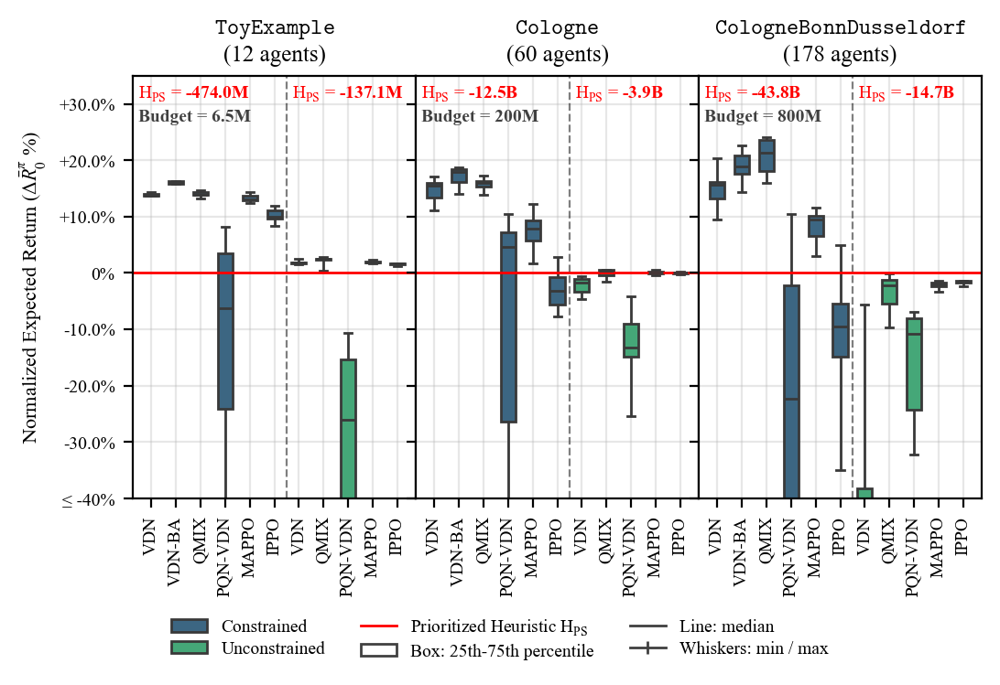
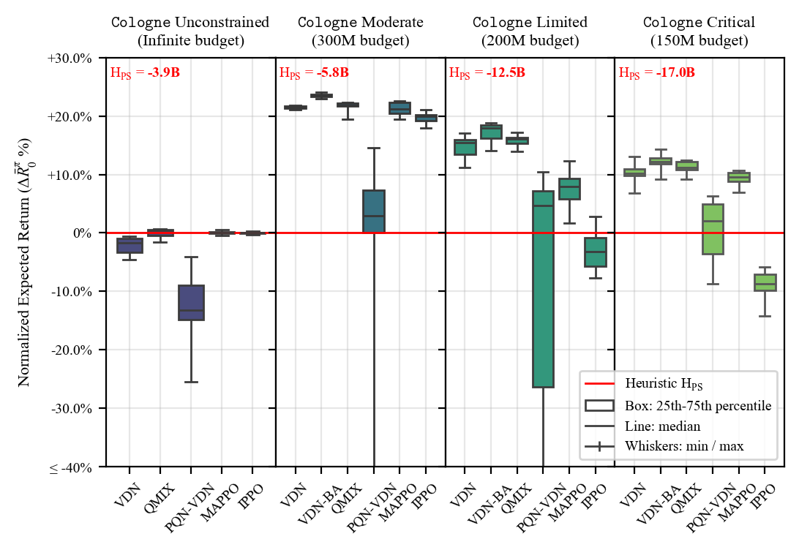

# JaxMARL for IMP-act
This repository integrates the [JaxMARL](https://github.com/FLAIROx/JaxMARL) library with [IMP-act](https://github.com/AI-for-Infrastructure-Management/imp-act), a multi-agent reinforcement learning (MARL) environment that models the interaction between maintenance actions and traffic dynamics in transportation networks under global budget constraints.

## Installation

### 1. Clone the repositories

To clone this repository together with the IMP-act repository, run:
```bash
git clone https://github.com/AI-for-Infrastructure-Management/imp-act-JaxMARL.git
cd imp-act-JaxMARL && git checkout submission
git clone https://github.com/AI-for-Infrastructure-Management/imp-act.git
```

### 2. Install the dependencies

The dependencies are pinned to the versions used for the final runs of the paper, in `uv.lock` for [uv](https://docs.astral.sh/uv/) and in [requirements/](requirements/) for pip. We recommend uv, which also installs Python 3.10 and is considerably faster than pip.

**Option A: uv (recommended)**

<details>
<summary>Installing uv</summary>

If uv is not installed, the easiest ways to install it are listed below, and further options are given in the [uv installation guide](https://docs.astral.sh/uv/getting-started/installation/),
```bash
curl -LsSf https://astral.sh/uv/install.sh | sh  # macOS and Linux
brew install uv                                  # macOS with Homebrew
pip install uv                                   # any system with Python and pip
```
On Windows, uv can be installed in PowerShell with `powershell -ExecutionPolicy ByPass -c "irm https://astral.sh/uv/install.ps1 | iex"`.
</details>

After [installing uv](https://docs.astral.sh/uv/getting-started/installation/), create the virtual environment `.venv` in the repository root and install the dependencies of the CPU version,
```bash
uv sync --all-extras
source .venv/bin/activate
```

The GPU version requires a Linux machine with an NVIDIA GPU and CUDA >= 12.8. To this end, the `cuda` dependency group adds the CUDA build of JAX,
```bash
uv sync --all-extras --group cuda
source .venv/bin/activate
python -c "import jax; print(jax.devices())"  # should return something like [cuda(id=0)]
```

**Option B: pip**

If uv is not available, the pinned versions can be installed with pip into a virtual environment created with Python 3.10 (e.g. from a system installation or a module on a computing cluster),
```bash
python3.10 -m venv .venv
source .venv/bin/activate
pip install -r requirements/cpu.txt  # or requirements/gpu.txt for the GPU version
pip install --no-deps -e . -e ./imp-act
```

<details>
<summary>Optional: Troubleshooting and Additional Notes</summary>

- If `cmake` is not installed, it can be installed with:
    ```bash
    sudo apt-get install cmake  # For Ubuntu/Debian
    brew install cmake          # For macOS
    ```
- Both options install JaxMARL and IMP-act in editable mode. With pip, the `--no-deps` flag ensures that only the pinned versions in `requirements/` are installed.
- After changing the dependencies in `pyproject.toml`, `uv lock` updates `uv.lock`, and the commands in the headers of `requirements/cpu.txt` and `requirements/gpu.txt` export the new versions for pip.
</details>

<details>
<summary>vast.ai GPU instance</summary>

Alternatively, a GPU instance can be created on vast.ai using the pre-built Docker image `omniscientoctopus/imp-act-jaxmarl`. When creating the instance, make sure to filter for GPUs with CUDA >= 12.8. The virtual environment of the image is activated by default, and the installation can then be checked with the examples below,

```bash
cd /workspace/imp-act-JaxMARL
```
</details>

### 3. Examples
The following examples check the installation of JaxMARL and of IMP-act with JaxMARL,
```bash
python experiments/example_mpe.py  # checks the JaxMARL installation
python experiments/example_road_env.py  # checks the IMP-act + JaxMARL installation
```

## Docker Image
Alternatively, the pre-built Docker image can be pulled from Docker Hub to get started quickly,
```bash
docker pull omniscientoctopus/imp-act-jaxmarl
```

## Results

### JAX speedup


The JAX implementation of IMP-act makes large-scale MARL experiments computationally feasible. When computing 1,000 environment rollouts, GPU-accelerated JAX is up to 239× faster than single-core NumPy. Similarly, end-to-end VDN training on `CologneBonnDusseldorf` with JaxMARL and JAX IMP-act is 90× faster than with EPyMARL and NumPy IMP-act (Figure 3 in the paper).

### Constrained and unconstrained environments


Under budget constraints, the best MARL policies outperform the heuristic policy H<sub>PS</sub> in all environments, whereas in the unconstrained environments, they offer marginal improvements over H<sub>PS</sub> or fall below it. Each boxplot summarizes the best expected return of each of the 10 training seeds, normalized with respect to H<sub>PS</sub> (ΔR̄<sup>π</sup><sub>0</sub>). VDN<sub>BA</sub> denotes the VDN policy with budget-aware action selection (Figure 4 and Section 6.1 in the paper).

### Budget scenarios in Cologne


In `Cologne`, the gain over H<sub>PS</sub> shrinks as the global budget decreases from moderate to limited to critical (Figure 5 in the paper).

These figures, together with the tables of the paper, can be reproduced with the code in [results/](results/README.md). The complete instructions for reproducing the results of the paper, including the training runs, are given in [Reproducing_Results.md](Reproducing_Results.md).


# Licence Disclaimer
This file is adapted from the [JaxMARL](https://github.com/FLAIROx/JaxMARL) repository and is used under the [Apache License 2.0](https://www.apache.org/licenses/LICENSE-2.0) (see [LICENSE](LICENSE)).
