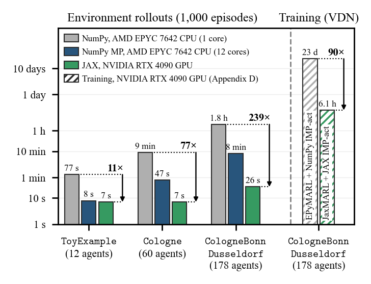

# JaxMARL for IMP-act
This repository integrates the [JaxMARL](https://github.com/FLAIROx/JaxMARL) library with [IMP-act](https://github.com/AI-for-Infrastructure-Management/imp-act), a multi-agent reinforcement learning (MARL) environment that models the interaction between maintenance actions and traffic dynamics in transportation networks under global budget constraints.

## Installation

### 1. Clone the repositories

To clone this repository together with the IMP-act repository, run:
```bash
git clone https://github.com/AI-for-Infrastructure-Management/imp-act-JaxMARL.git
cd imp-act-JaxMARL && git checkout submission
git clone https://github.com/AI-for-Infrastructure-Management/imp-act.git
```

### 2. Create a virtual environment

**Option A:** Create a conda environment using the environment YAML file,
```bash
conda env create -f conda_environment.yaml
conda activate impact-jaxmarl-env
```

**Option B:** Alternatively, create a virtual environment `impact-jaxmarl-env` with Python 3.10 (e.g., using venv) and install Poetry,
```bash
pip install poetry==1.7.1 lockfile==0.12.2
```

### 3. Install dependencies

**Option A: JAX CPU version**

Install the dependencies of JaxMARL using `pyproject.toml`,
```bash
pip install -e ".[algs]"
```

and the dependencies of IMP-act,
```bash
cd imp-act && git checkout main
poetry install --with dev,vis,jax
```
<details>
<summary>Optional: Troubleshooting and Additional Notes</summary>

- If `cmake` is not installed, it can be installed with:
    ```bash
    sudo apt-get install cmake  # For Ubuntu/Debian
    brew install cmake          # For macOS
    ```
</details>

**Option B: JAX GPU version**

The GPU version requires JAX with CUDA support (CUDA >= 12.8). To this end, replace `"jax==0.4.30"` with `"jax[cuda12]==0.4.30"` in `pyproject.toml` before installing the dependencies of JaxMARL, and install IMP-act with the `jax_gpu` group,

```bash
pip install -e ".[algs]"
python -c "import jax; print(jax.devices())"  # should return something like [cuda(id=0)]

cd imp-act && git checkout main
poetry install --with dev,vis,jax_gpu
```

<details> 
<summary>vast.ai GPU instance</summary>

Alternatively, a GPU instance can be created on vast.ai using the pre-built Docker image `omniscientoctopus/imp-act-jaxmarl`. When creating the instance, make sure to filter for GPUs with CUDA >= 12.8. The installation can then be checked with the examples below,

```bash
cd imp-act-JaxMARL && conda activate impact-jaxmarl-env
```
</details>

### 4. Examples
The following examples check the installation of JaxMARL and of IMP-act with JaxMARL,
```bash
cd ..  # return to imp-act-JaxMARL
python experiments/example_mpe.py  # checks the JaxMARL installation
python experiments/example_road_env.py  # checks the IMP-act + JaxMARL installation
```

## Docker Image
Alternatively, the pre-built Docker image can be pulled from Docker Hub to get started quickly,
```bash
docker pull omniscientoctopus/imp-act-jaxmarl
```

## Results

### JAX speedup


The JAX implementation of IMP-act makes large-scale MARL experiments computationally feasible. When computing 1,000 environment rollouts, GPU-accelerated JAX is up to 239× faster than single-core NumPy. Similarly, end-to-end VDN training on `CologneBonnDusseldorf` with JaxMARL and JAX IMP-act is 90× faster than with EPyMARL and NumPy IMP-act (Figure 3 in the paper).

### Constrained and unconstrained environments


Under budget constraints, the best MARL policies outperform the heuristic policy H<sub>PS</sub> in all environments, whereas in the unconstrained environments, they offer marginal improvements over H<sub>PS</sub> or fall below it. Each boxplot summarizes the best expected return of each of the 10 training seeds, normalized with respect to H<sub>PS</sub> (ΔR̄<sup>π</sup><sub>0</sub>). VDN<sub>BA</sub> denotes the VDN policy with budget-aware action selection (Figure 4 and Section 6.1 in the paper).

### Budget scenarios in Cologne


In `Cologne`, the gain over H<sub>PS</sub> shrinks as the global budget decreases from moderate to limited to critical (Figure 5 in the paper).

These figures, together with the tables of the paper, can be reproduced with the code in [results/](results/README.md). The complete instructions for reproducing the results of the paper, including the training runs, are given in [Reproducing_Results.md](Reproducing_Results.md).


# Licence Disclaimer
This file is adapted from the [JaxMARL](https://github.com/FLAIROx/JaxMARL) repository and is used under the [Apache License 2.0](https://www.apache.org/licenses/LICENSE-2.0) (see [LICENSE](LICENSE)).
